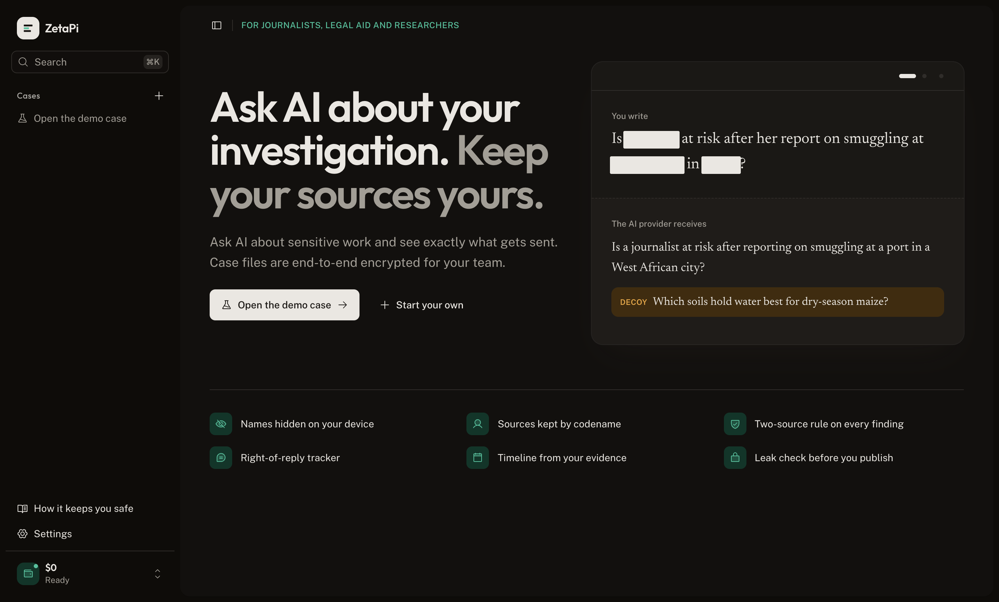
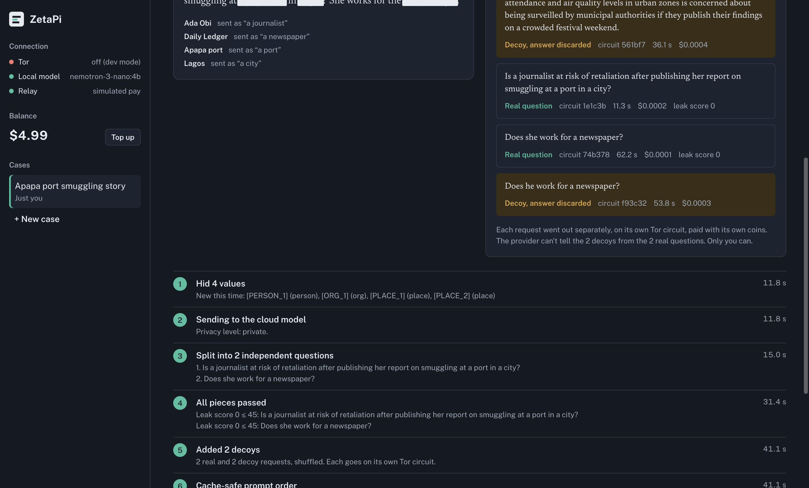
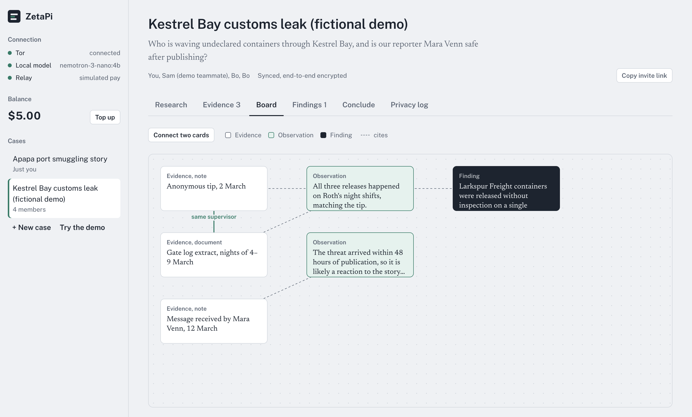

# Zireh

**Investigate together. Ask powerful AI. Keep your sources to yourselves.**

Zireh is a collaborative research tool for people who handle sensitive material: journalists,
legal-aid teams, human-rights researchers. A team collects evidence, builds a case board, reviews
each other's findings and publishes a conclusion. When they ask an AI for help, Zireh makes sure
the AI provider learns as little as possible about **who** is asking and **what** the case is.



## The problem

Cloud AI is the most useful research tool there is, and the most dangerous one to paste a source's
name into. A provider sees your IP, your account, your payment details and every word you send, and
can join them into a profile. Local models are private but much weaker. Zireh lets a small local
model protect the question, and a large cloud model answer it.

## What happens when you ask a question

Everything up to "send" runs on your computer, using **NVIDIA Nemotron 3 Nano 4B** (via Ollama).

| # | Step | What it does |
|---|---|---|
| 1 | **Redact** | Finds names, organizations, places, IDs, contacts and amounts. Each becomes a placeholder with a deliberately vague description ("Lagos" → "a city in West Africa"). Pattern detectors + model extraction + a second classification pass for anything missed. |
| 2 | **Route** | "Local only" stops here and answers on your computer. |
| 3 | **Rewrite / split** | Turns the task into self-contained general questions. Higher levels split it so no single question reveals the whole situation. |
| 4 | **Leak check** | The local model plays the provider: "what could I infer about this person?" Risky pieces are generalized once, then blocked. A deterministic floor blocks any piece containing a hidden value, whatever the model says. |
| 5 | **Decoys** | Plausible cover questions on unrelated topics. Near-duplicates and decoys with odd placeholders are rejected, because they'd point at the real question. |
| 6 | **Send** | Every piece, real or decoy, goes out on **its own Tor circuit**, paid with **its own unlinkable ecash coins**, to the relay's **onion service**. |
| 7 | **Reassemble** | Decoy answers are discarded; real answers are combined locally with citations that are checked in code, and the hidden names are put back. |



### Privacy levels

| Level | Leaves your computer | Decoys per question | Split |
|---|---|---|---|
| Local only | nothing | – | – |
| Standard | one generalized question | 0 | no |
| Private | several independent questions | 1 | yes |
| Paranoid | same, stricter leak threshold | 3 | yes |

## Who sees what

| | Your computer | Relay | Sync host | AI provider |
|---|---|---|---|---|
| Your IP | ✓ | – (onion service) | – (onion service) | – |
| Names, places, case details | ✓ | – | – (ciphertext) | – |
| Generalized question pieces | ✓ | ✓ | – | ✓ |
| Which pieces are decoys / belong together | ✓ | – | – | – |
| Who paid | ✓ | – (blind-signed coins) | – | – |
| Team membership and case files | ✓ | – | ciphertext only | – |

## Collaboration (end-to-end encrypted)

- **Cases** with evidence (notes, documents, links, images), observations, findings, reviews,
  comments, a draggable **case board** with labeled connections, and a **conclusion**
  (resolved / unresolved / disputed) with revisions.
- **Invite links** carry the case key in the URL fragment, which browsers never send to a server.
- **Sync host** stores sealed records in an append-only log. It checks a one-way token so only
  members can write, and never sees a key or plaintext. Devices repair a reset or replaced host
  automatically.
- **Images** are re-encoded on your computer before they become evidence, dropping GPS, camera
  and time metadata.
- **Findings page**: export a single self-contained HTML page with a SHA-256 content hash, with
  names hidden (using the same descriptions the AI saw) or shown.
- **Privacy log**: every payload that left the computer, exactly as sent, with its hash and cost.
- **Fictional demo case** to try everything without real material.



## Use it from any AI tool

The daemon also speaks the OpenAI API, so agent harnesses, editors and scripts can route
through the full privacy pipeline by changing one URL:

```bash
export OPENAI_BASE_URL=http://127.0.0.1:7878/v1
export OPENAI_API_KEY=$(cat .zireh/daemon/local-api-key)   # created on first start, owner-only
# models: zireh/local, zireh/standard, zireh/private, zireh/paranoid
# or pick the level per request with the header  x-zireh-level: private
```

Each request is redacted, generalized, split and decoyed like a research question, sent over
Tor, and answered with names restored. Every request shows up in the privacy log.

## Payments: per-token billing without identity

1. Top up any amount with a shielded Zcash payment to a fresh address.
2. The relay issues **blind-signed ecash coins** (Cashu-style BDHKE, verified against the Cashu
   NUT-00 test vectors). The relay can't link coins to the payment or to each other.
3. Each call pays the **worst case** (input bound + `max_tokens`); the relay returns **change**
   as fresh blind-signed coins. You pay exactly per token, with no account.
4. Your client **audits every bill**: it recomputes the cost from the reported usage and flags
   overcharges, including hidden reasoning tokens beyond the cap you set.
5. Dropped connections never cost twice: calls are idempotent by request id and recovered
   automatically.

## NVIDIA Nemotron and Nebius Token Factory

| Where | Model | Role |
|---|---|---|
| On your computer (Ollama) | `nemotron-3-nano:4b` | Redaction, hints, classification, rewriting, splitting, leak check, decoys, reassembly. Runs in non-reasoning mode: each stage takes about 1 s on an M1 instead of about 10 s. |
| Relay → **Nebius Token Factory** | `nvidia/nemotron-3-super-120b-a12b` (default), `nvidia/Llama-3_1-Nemotron-Ultra-253B-v1` | Answers the generalized questions. Called through Token Factory's OpenAI-compatible API (`https://api.tokenfactory.nebius.com/v1`) with the relay's key. |

Without a `NEBIUS_API_KEY` the relay runs in **local-dev mode**: it answers with the local Nano
model and says so everywhere (logs, UI, model name). Nothing is ever labeled as Token Factory when
it isn't.

**Tavily** (optional): the relay offers paid web search through Tavily; the daemon redacts the
query first and sends it over Tor like any other call.

## Architecture

A monorepo of small packages in strict layers. A package may only import from lower layers;
`pnpm check:layers` enforces it.

| Layer | Packages |
|---|---|
| L0 | `schema` (contracts and validators), `crypto` (hashing, AES-GCM case box, BDHKE) |
| L1 | `llm` (one OpenAI-compatible client for local and cloud models, JSON helper) |
| L2 | `redact`, `split`, `leakcheck`, `decoy` (privacy stages) |
| L3 | `shield` (composes the stages into a pipeline with a live trace) |
| L4 | `tor` (circuit-isolated transport, onion services), `wallet` (mint, wallet, pricing, bill audit), `zcash` (payment watcher) |
| L5 | `inference` (paid, idempotent relay client), `relay-core` (relay handler) |
| L6 | `ledger` (run state machine, privacy log) |
| L7 | `cases` (collaboration domain, publication), `sync` (sealed envelopes) |

| App | Runs | Composes |
|---|---|---|
| `apps/daemon` | your computer (127.0.0.1) | local model, shield, Tor, wallet, ledger, sync proxy; serves the UI |
| `apps/web` | your browser | cases, sync, encryption, UI |
| `apps/relay` | server, as an onion service | relay-core, Token Factory, Tavily, mint |
| `apps/sync-host` | server, as an onion service | ciphertext log |

More detail: [`context/architecture.md`](context/architecture.md), design decisions and measured
numbers: [`context/decisions.md`](context/decisions.md).

## Run it

Requirements: Node 22+, pnpm, [Ollama](https://ollama.com), Tor (`brew install tor ollama`).

```bash
pnpm install
ollama pull nemotron-3-nano:4b
cp .env.example .env          # optional: NEBIUS_API_KEY, TAVILY_API_KEY
pnpm dev                      # Tor mode: relay and sync host as onion services
# open http://127.0.0.1:7878, top up (simulated Zcash), try the demo case
```

`pnpm dev --direct` skips Tor for fast local iteration; the UI shows Tor as off.

```bash
pnpm check        # layer check + typecheck + 109 tests
pnpm smoke:tor    # live: three requests on three circuits, three different exits
```

## Measured on an M1 MacBook (8 GB)

| | |
|---|---|
| Tor cold bootstrap | ~78 s (first run only) |
| Tor warm bootstrap | 3.4 s |
| HTTPS request on a fresh circuit | 1.0–2.2 s |
| Local pipeline stage (Nano, non-reasoning) | ~1 s each |
| Private-level question, local-dev upstream | 40–180 s (the "cloud" model shares the laptop GPU) |

## Honest limits

- **Zcash intake is simulated.** The relay uses a labeled simulated network; a viewing-key watcher
  on testnet is designed (`zcash.PaymentWatcher`) but not built.
- **Tor helps against passive observers.** An adversary who controls both your guard and the
  relay could correlate timing. A mixnet with constant cover traffic would be stronger.
- **Topic still leaks.** Generalization hides who and where, not what the question is about.
- **Images stay local.** They're stripped and shared with the team, not sent to the AI.
- **The device is the trust boundary.** Case keys and coins live unencrypted in this browser's
  storage and the daemon's data folder; protect the computer (disk encryption, screen lock).
- **Pseudonym tables merge by union.** If a teammate's device still has a value marked for
  hiding, it can come back after you chose "Don't hide". Hiding more is the safe failure.
- **Small-model judgment.** Nano 4B can miss a name; that's why there are pattern detectors, a
  second classification pass and a deterministic leak floor. The privacy log shows exactly what
  was sent, so a miss is visible.

## Built for the Nebius × NVIDIA Global AI Hackathon

Track: **Personal AI**. All code in this repository was written during the submission period
(October 2026); see the git history.

### Feedback on the tools

- **Nemotron 3 Nano 4B** is a good fit for on-device privacy work. Turning reasoning off
  (`reasoning_effort: "none"` in Ollama) cut a typical stage from 9.9 s to 1.2 s with the same
  result. Two quirks to know: it copies examples from prompts verbatim (we removed copyable
  examples), and it's better at *classifying* a given list of phrases than *extracting* names
  from free text, so we use both.
- **Reasoning-token billing** needs to be visible to callers. A client that wants to verify its
  bill can count visible output but not hidden reasoning. Reporting
  `completion_tokens_details.reasoning_tokens` consistently would let every client audit costs.
- **Token Factory** being OpenAI-compatible meant one client serves both the local model and the
  cloud, which kept the architecture simple. The docs we found didn't state vision support or
  prompt-caching behavior for Nemotron models; clear statements there would help privacy-sensitive
  designs (we keep images local and isolate cache prefixes per case to be safe).

## License

MIT. See [LICENSE](LICENSE).
