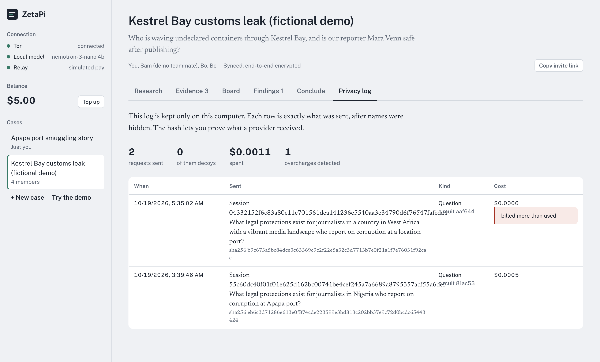

# Zireh

**Investigate together. Ask powerful AI. Keep your sources to yourselves.**

Zireh is a collaborative research tool for journalists, legal-aid teams and human-rights
researchers. A team collects evidence, builds a case board, reviews findings and publishes a
conclusion. When they ask an AI for help, the provider learns as little as possible about **who**
is asking and **what** the case is.


## What happens when you ask a question

Everything before "send" runs in your browser, optionally with **NVIDIA Nemotron 3 Nano 4B** on
the graphics card (WebGPU, about 2.5 GB, downloaded once).

1. **Redact.** Names, organizations, places, IDs and amounts become placeholders with vague
   descriptions ("Lagos" → "a city in West Africa").
2. **Rewrite and split** into self-contained general questions, so no single one tells the story.
3. **Leak check.** The model plays the provider and asks what it could infer; risky pieces are
   generalized or blocked. Any piece still containing a hidden value is always blocked.
4. **Decoys.** Plausible cover questions on unrelated topics go out alongside the real ones.
5. **Send.** Each piece is its own request, paid with its own unlinkable ecash coins.
6. **Reassemble** the real answers locally and put the names back.

Without the on-device model, names are hidden by rule and each question goes out whole.

| Level | Leaves your browser | Decoys | Split |
|---|---|---|---|
| Local only | nothing | – | – |
| Standard | one generalized question | 0 | no |
| Private | several independent questions | 1 | yes |
| Paranoid | same, stricter leak check, review before send | 3 | yes |


## Who sees what

| | Your browser | Host (relay + sync) | AI provider |
|---|---|---|---|
| Your IP address | ✓ | ✓ | – |
| Names, places, case details | ✓ | – (sync stores ciphertext) | – |
| Generalized question pieces | ✓ | ✓ | ✓ |
| Which pieces are decoys or belong together | ✓ | – | – |
| Who paid | ✓ | – (blind-signed coins) | – |

## Working as a team

- **Cases** hold evidence (notes, documents, links, images), observations, findings with
  reviews, comments, a case board and a conclusion.
- **Invite links** carry the case key in the URL fragment, which browsers never send to a server.
- **The sync host** stores sealed records only; a one-way token decides who may write. Records
  are signed by their author, and removing a member rotates the key.
- **Images** are re-encoded to drop GPS and camera metadata; faces and plates can be pixelated.
- **Privacy log**: every paid request is recorded before sending, exactly as it left, with cost.
- **Conclude** exports one self-contained HTML page with a content hash, names hidden or shown.
- **Encrypted backups** of a case, protected by a passphrase.




## Paying without an account

1. Ask for a quote. The host gives it its own Zcash address; pay it from any wallet.
2. The host issues **blind-signed ecash coins** (Cashu-style BDHKE). It can't link coins to the
   payment or to each other, and the coins live in your browser.
3. Each call pays the worst case; the change comes back as fresh coins.
4. The browser **checks every bill** against the tokens used, hidden reasoning included.
5. A dropped connection never costs twice: calls are retried with the same id and recovered.

Top-ups are **simulated** by default ("Mark as paid"). With `ZCASH_UFVK` set, the host watches
real shielded payments with a viewing key only (testnet by default). Free coins can't fund a paid
AI provider unless `RELAY_DEMO=1`, which caps provider spend per day.

## The AI behind the relay

Any OpenAI-compatible provider: Nebius Token Factory with Nemotron models by default, or Meta's
Model API, OpenRouter, vLLM and others via `LLM_API_KEY`, `LLM_BASE_URL`, `LLM_MODELS` and
`LLM_EXTRA_BODY` (see `.env.example`). Without a key the host runs in a labeled local-dev mode
against Ollama. Optional web search goes through Tavily.

## Layout

| Folder | Runs | What |
|---|---|---|
| `app/` | browser | UI, wallet, privacy pipeline, on-device model, encrypted case store |
| `packages/` | browser | `schema`, `crypto`, `llm`, `shield` (privacy pipeline), `wallet`, `relay-client`, `cases`, `sync`, in strict layers (`pnpm check:layers`) |
| `host/` | server | One Rust binary: relay, ecash mint, Zcash payments and sync ([host/README.md](host/README.md)) |

## Run it

Needs Node 22.19+, pnpm and a Rust toolchain.

```bash
pnpm install
cp .env.example .env    # optional: AI provider, payments
pnpm dev                # host on :8788, app on :5173
pnpm check              # layers, types and tests
```

Set `VITE_HOST_URL` when building the app to use a deployed host.

## Limits

- **No network anonymity.** The host sees your IP address, though not your name, the hidden
  values or which pieces belong together. Use a trusted VPN if your address matters.
- **The topic still leaks.** Generalization hides who and where, not what the question is about.
- **The device is the trust boundary.** Keys and coins sit unencrypted in browser storage;
  clearing site data deletes the coins, and backups don't include them yet.
- **Real Zcash intake hasn't received a testnet payment yet.**
- **A small model can miss a name.** Pattern detectors and the leak floor back it up, and the
  privacy log shows exactly what was sent.

## License

MIT. See [LICENSE](LICENSE).
